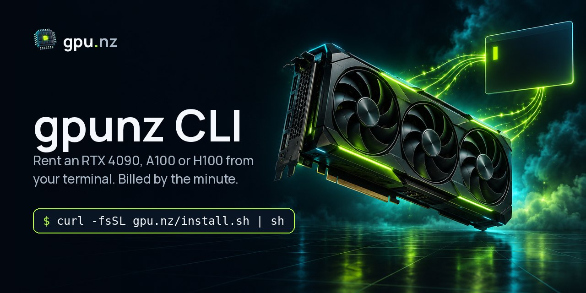

<div align="center">



# gpunz — command-line client for the gpu.nz GPU cloud

**Rent an RTX 4090, A100 or H100 from your terminal, billed by the minute.**
Search live GPU offers, launch ComfyUI, Jupyter, Ollama or vLLM in one command, SSH in, stop when you are done.

[](https://github.com/gpunz/gpunz-cli/actions/workflows/ci.yml)
[](https://github.com/gpunz/gpunz-cli/releases)
[](go.mod)
[](LICENSE)

[Website](https://gpu.nz) · [Pricing](https://gpu.nz/pricing) · [CLI docs](https://gpu.nz/docs/cli) · [REST API](https://gpu.nz/api/v1/openapi.json) · [Examples](https://github.com/gpunz/examples) · [Русский](#русский)

</div>

---

## Why gpunz

- **Per-minute billing.** A stopped server stops costing GPU time; you see the hourly price before you rent.
- **Any GPU.** From RTX 3060 to RTX 4090/5090, A100, H100, H200 and B200, on demand or interruptible (cheaper).
- **One-command environments.** Templates for ComfyUI, Stable Diffusion Forge, JupyterLab, Ollama + Open WebUI, vLLM (OpenAI-compatible API), PyTorch, or your own Docker image.
- **Scriptable.** Every command has `--json`, so it fits shell scripts, CI and agents.
- **Top up from the terminal.** `gpunz topup 500` draws a QR code you scan with your phone to pay by SBP.
- **Single static binary.** Linux, macOS and Windows, amd64 and arm64. No runtime to install.

## Install

```sh
# Linux / macOS
curl -fsSL https://gpu.nz/install.sh | sh

# Windows (PowerShell)
irm https://gpu.nz/install.ps1 | iex

# From source (Go 1.22+)
go install github.com/gpunz/gpunz-cli/cmd/gpunz@latest
```

The installers verify the binary against `SHA256SUMS` before installing. Prebuilt binaries are also attached to every [GitHub release](https://github.com/gpunz/gpunz-cli/releases). Update later with `gpunz update`.

## Quick start

```sh
gpunz login                                   # opens the browser to approve this device
gpunz topup 500                               # pay by SBP: scan the QR code in the terminal with your phone
gpunz gpus                                    # GPU models, VRAM, free units and the lowest price
gpunz search --gpu rtx-4090-24gb --limit 5    # live offers, cheapest first
gpunz templates                               # ComfyUI, Jupyter, Ollama, vLLM, ...
gpunz create OFFER_ID --template comfyui --disk 60
gpunz instances                               # your servers and their status
gpunz ssh INSTANCE_ID                         # SSH straight into the server
gpunz stop INSTANCE_ID                        # stop paying for the GPU, keep the disk
gpunz destroy INSTANCE_ID                     # delete the server and its disk
```

Example output:

```text
$ gpunz search --gpu rtx-4090-24gb --limit 3
ID          GPU          VRAM   CPU     RAM     DISK     NET ↓/↑      RELIAB.  COUNTRY  ON DEMAND   INTERRUPTIBLE
50hfa8895b  RTX 4090 ×1  24 GB  —       7 GB    1440 GB  347/10 Mbps  96.3%    US       32.90 ₽/h   —
nma699m6rx  RTX 4090 ×1  24 GB  —       7 GB    1440 GB  658/18 Mbps  96.5%    US       32.90 ₽/h   —
hh5qwswn7b  RTX 4090 ×1  24 GB  8 vCPU  126 GB  329 GB   840/98 Mbps  99.5%    AU       60.90 ₽/h   39.90 ₽/h
```

Prices change with the market; the CLI always shows the live price.

## Commands

| Command | What it does |
|---|---|
| `login [--key KEY] [--no-browser]` | Sign in with the browser device flow, or save an API key |
| `logout` / `whoami` | Forget the saved key / show the signed-in account |
| `balance` | Balance and how long it lasts at the current spend |
| `topup [AMOUNT]` | Top up: opens the payment page (SBP or crypto) and draws its link as a QR code for your phone camera |
| `gpus` | GPU models with VRAM, availability and the lowest price |
| `search [filters]` | Rentable offers: `--gpu`, `--num-gpus`, `--type on_demand\|interruptible`, `--max-price`, `--country`, `--min-vram`, `--min-cuda`, `--min-disk`, `--min-down`, `--verified`, `--order`, `--limit` |
| `templates` | Launch templates (ComfyUI, Forge, Jupyter, Ollama, vLLM, PyTorch, ...) |
| `create OFFER_ID --template SLUG` | Rent an offer: `--disk GB`, `--name`, `--ssh-key`, `--env KEY=VALUE`, `--onstart` |
| `instances` / `ls` | Your servers (`--all` includes deleted ones) |
| `show ID` / `logs ID [--tail N]` | Details and logs of one server |
| `start ID` / `stop ID` / `destroy ID [-y]` | Lifecycle; a stopped server keeps its disk |
| `ssh ID [ssh args...]` | Open an SSH session |
| `ssh-keys [ls\|add PATH\|rm ID]` | Manage SSH keys |
| `api-keys [ls\|create --name N\|rm ID]` | Manage API keys for scripts and CI |
| `update`, `version`, `completion bash\|zsh\|fish\|powershell` | Self-update, version, shell completion |

Global flags: `--json` (machine-readable output), `--api-key KEY`, `--api-url URL`.

## Scripting

```sh
# cheapest on-demand RTX 4090 as JSON
gpunz --json search --gpu rtx-4090-24gb --type on_demand --limit 1 | jq '.data[0]'

# use an API key in CI instead of the browser login
export GPUNZ_API_KEY=gpz_xxx
gpunz --json instances
```

Configuration lives in your user config directory; `GPUNZ_API_KEY` and `GPUNZ_API_URL` override it. More recipes, Python and notebooks: [gpunz/examples](https://github.com/gpunz/examples).

## Build from source

```sh
go test ./...
go build -o gpunz ./cmd/gpunz
./build.sh   # cross-compile every platform into dist/ with SHA256SUMS
```

## Security

The CLI talks only to `https://gpu.nz/api/v1` over HTTPS, stores the API key in your user config file with owner-only permissions, and verifies downloaded updates against `SHA256SUMS`. Please report vulnerabilities privately: see [SECURITY.md](SECURITY.md).

---

## Русский

**gpunz** — консольный клиент облака [gpu.nz](https://gpu.nz): аренда видеокарт для нейросетей прямо из терминала, оплата поминутно, в рублях (СБП) или криптовалютой.

- **Любая видеокарта:** RTX 3060, RTX 4090/5090, A100, H100, H200, B200. По требованию или прерываемые, они дешевле.
- **Готовые окружения одной командой:** ComfyUI, Stable Diffusion Forge, JupyterLab, Ollama + Open WebUI, vLLM с OpenAI-совместимым API, PyTorch или свой Docker-образ.
- **Поминутная оплата:** цена за час видна до запуска, остановленный сервер не платит за GPU.
- **Для скриптов:** у каждой команды есть `--json`.

```sh
curl -fsSL https://gpu.nz/install.sh | sh     # Linux / macOS
irm https://gpu.nz/install.ps1 | iex          # Windows

gpunz login
gpunz topup 500                               # QR-код для оплаты по СБП с телефона
gpunz search --gpu rtx-4090-24gb --limit 5
gpunz create OFFER_ID --template comfyui
gpunz ssh INSTANCE_ID
gpunz stop INSTANCE_ID
```

Документация: [gpu.nz/docs/cli](https://gpu.nz/docs/cli) · Цены: [gpu.nz/pricing](https://gpu.nz/pricing) · Примеры: [gpunz/examples](https://github.com/gpunz/examples)

## License

[MIT](LICENSE) © 2026 gpu.nz
